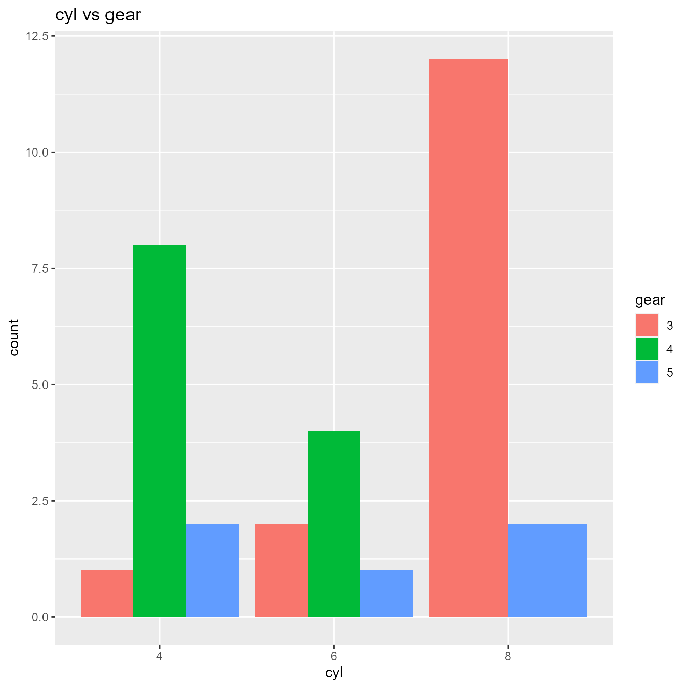
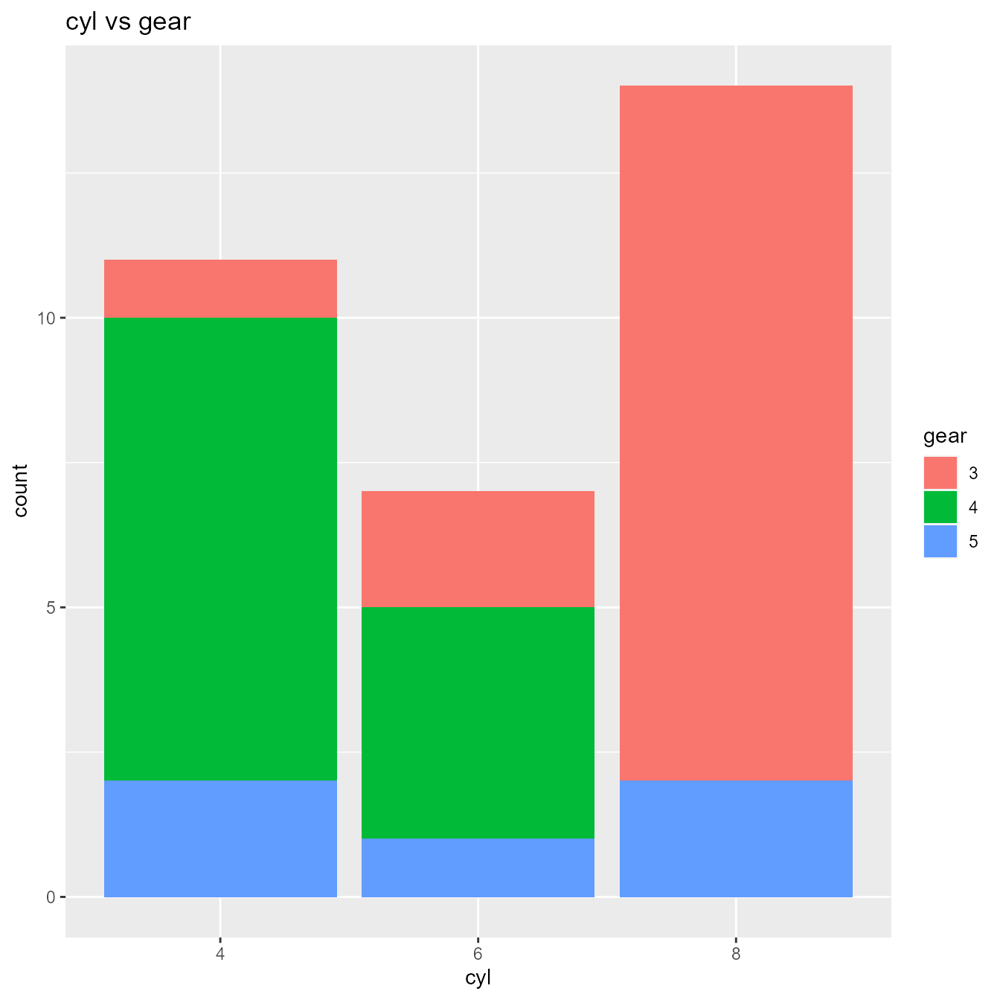
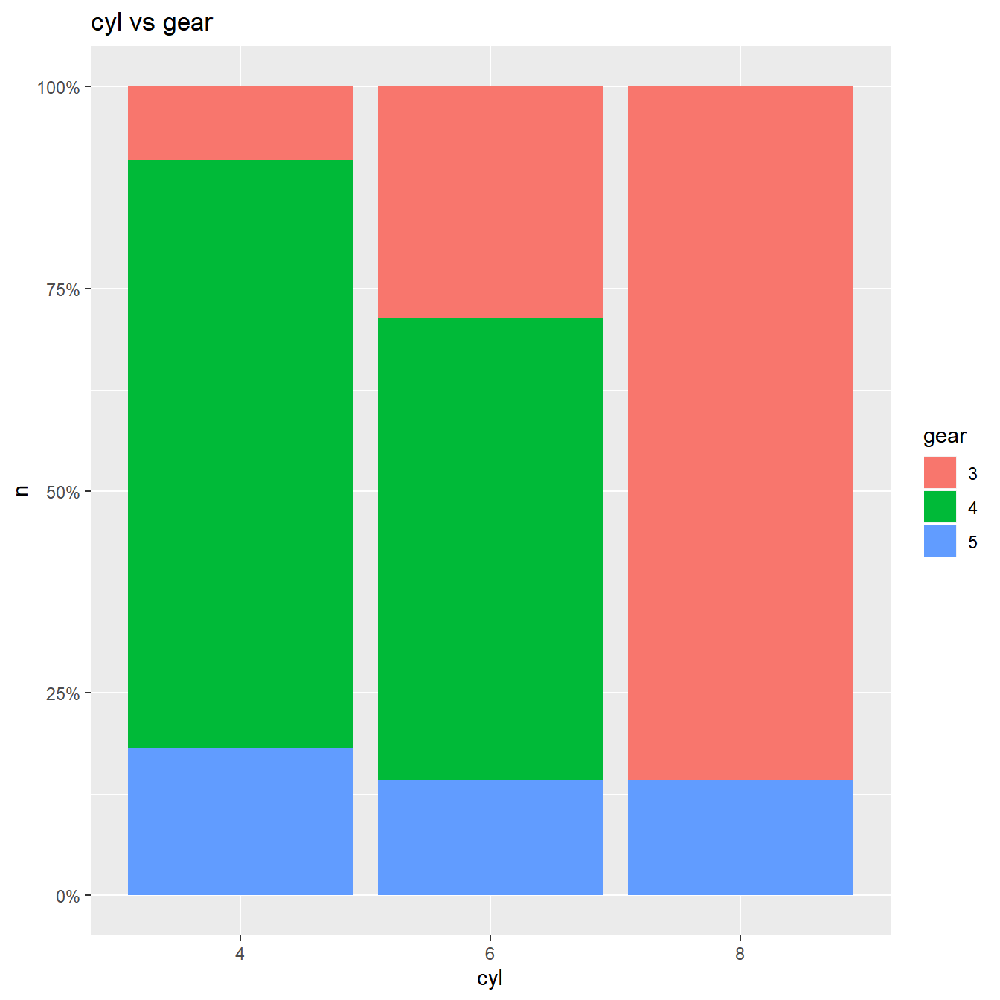
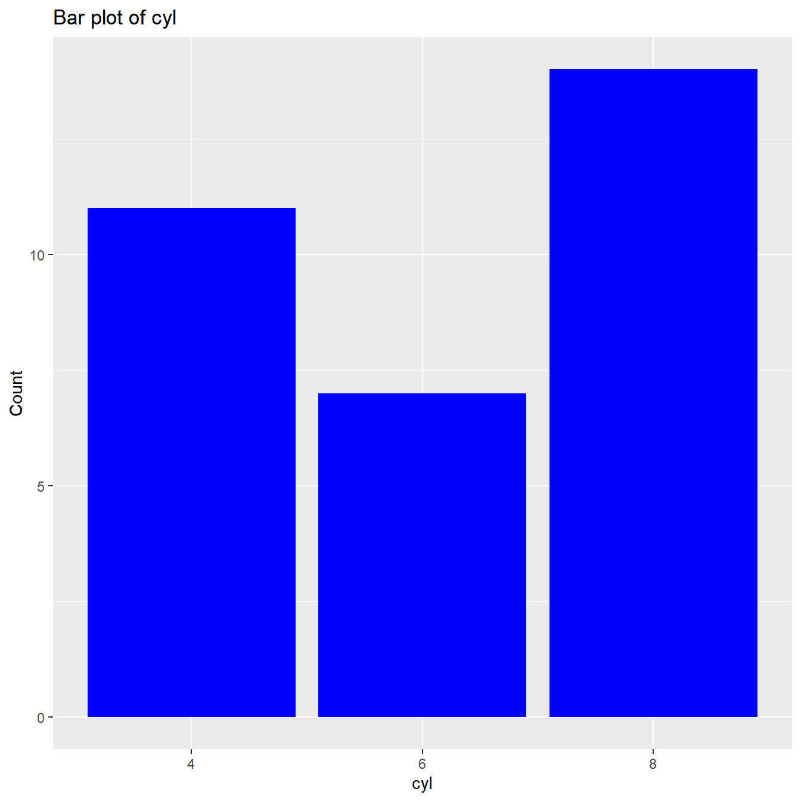

# Categorical Data

    #> Warning: package 'dplyr' was built under R version 4.5.3

## Introduction

In this document, we will introduce you to functions for exploring and
visualizing categorical data.

## Data

We have modified the `mtcars` data to create a new data set `mtcarz`.
The only difference between the two data sets is related to the variable
types.

[`str`](https://rdrr.io/r/utils/str.html)`(``mtcarz``)`` ``#> 'data.frame': 32 obs. of 11 variables:`` ``#> $ mpg : num 21 21 22.8 21.4 18.7 18.1 14.3 24.4 22.8 19.2 ...`` ``#> $ cyl : Factor w/ 3 levels "4","6","8": 2 2 1 2 3 2 3 1 1 2 ...`` ``#> $ disp: num 160 160 108 258 360 ...`` ``#> $ hp : num 110 110 93 110 175 105 245 62 95 123 ...`` ``#> $ drat: num 3.9 3.9 3.85 3.08 3.15 2.76 3.21 3.69 3.92 3.92 ...`` ``#> $ wt : num 2.62 2.88 2.32 3.21 3.44 ...`` ``#> $ qsec: num 16.5 17 18.6 19.4 17 ...`` ``#> $ vs : Factor w/ 2 levels "0","1": 1 1 2 2 1 2 1 2 2 2 ...`` ``#> $ am : Factor w/ 2 levels "0","1": 2 2 2 1 1 1 1 1 1 1 ...`` ``#> $ gear: Factor w/ 3 levels "3","4","5": 2 2 2 1 1 1 1 2 2 2 ...`` ``#> $ carb: Factor w/ 6 levels "1","2","3","4",..: 4 4 1 1 2 1 4 2 2 4 ...`

## Cross Tabulation

The
[`ds_cross_table()`](https://descriptr.rsquaredacademy.com/reference/ds_cross_table.md)
function creates two way tables of categorical variables.

[`ds_cross_table`](https://descriptr.rsquaredacademy.com/reference/ds_cross_table.md)`(``mtcarz``, ``cyl``, ``gear``)`` ``#> Cell Contents`` ``#> |---------------|`` ``#> | Frequency |`` ``#> | Percent |`` ``#> | Row Pct |`` ``#> | Col Pct |`` ``#> |---------------|`` ``#> `` ``#> Total Observations: 32 `` ``#> `` ``#> ----------------------------------------------------------------------------`` ``#> | | gear |`` ``#> ----------------------------------------------------------------------------`` ``#> | cyl | 3 | 4 | 5 | Row Total |`` ``#> ----------------------------------------------------------------------------`` ``#> | 4 | 1 | 8 | 2 | 11 |`` ``#> | | 0.031 | 0.25 | 0.062 | |`` ``#> | | 0.09 | 0.73 | 0.18 | 0.34 |`` ``#> | | 0.07 | 0.67 | 0.4 | |`` ``#> ----------------------------------------------------------------------------`` ``#> | 6 | 2 | 4 | 1 | 7 |`` ``#> | | 0.062 | 0.125 | 0.031 | |`` ``#> | | 0.29 | 0.57 | 0.14 | 0.22 |`` ``#> | | 0.13 | 0.33 | 0.2 | |`` ``#> ----------------------------------------------------------------------------`` ``#> | 8 | 12 | 0 | 2 | 14 |`` ``#> | | 0.375 | 0 | 0.062 | |`` ``#> | | 0.86 | 0 | 0.14 | 0.44 |`` ``#> | | 0.8 | 0 | 0.4 | |`` ``#> ----------------------------------------------------------------------------`` ``#> | Column Total | 15 | 12 | 5 | 32 |`` ``#> | | 0.468 | 0.375 | 0.155 | |`` ``#> ----------------------------------------------------------------------------`

If you want the above result as a tibble, use
[`ds_twoway_table()`](https://descriptr.rsquaredacademy.com/reference/ds_cross_table.md).

[`ds_twoway_table`](https://descriptr.rsquaredacademy.com/reference/ds_cross_table.md)`(``mtcarz``, ``cyl``, ``gear``)`` ``` #> Joining with `by = join_by(cyl, gear, count)` ``` ``#> ``# A tibble: 8 × 6`` ``#> cyl gear count percent row_percent col_percent`` ``#> ``<fct>`` ``<fct>`` ``<int>`` ``<dbl>`` ``<dbl>`` ``<dbl>`` ``#> ``1`` 4 3 1 0.031``2`` 0.090``9`` 0.066``7`` ``#> ``2`` 4 4 8 0.25 0.727 0.667 `` ``#> ``3`` 4 5 2 0.062``5`` 0.182 0.4 `` ``#> ``4`` 6 3 2 0.062``5`` 0.286 0.133 `` ``#> ``5`` 6 4 4 0.125 0.571 0.333 `` ``#> ``6`` 6 5 1 0.031``2`` 0.143 0.2 `` ``#> ``7`` 8 3 12 0.375 0.857 0.8 `` ``#> ``8`` 8 5 2 0.062``5`` 0.143 0.4`

A [`plot()`](https://rdrr.io/r/graphics/plot.default.html) method has
been defined which will generate:

### Grouped Bar Plots

`k`` ``<-`` `[`ds_cross_table`](https://descriptr.rsquaredacademy.com/reference/ds_cross_table.md)`(``mtcarz``, ``cyl``, ``gear``)`` `[`plot`](https://rdrr.io/r/graphics/plot.default.html)`(``k``)`



### Stacked Bar Plots

`k`` ``<-`` `[`ds_cross_table`](https://descriptr.rsquaredacademy.com/reference/ds_cross_table.md)`(``mtcarz``, ``cyl``, ``gear``)`` `[`plot`](https://rdrr.io/r/graphics/plot.default.html)`(``k``, stacked ``=`` ``TRUE``)`



### Proportional Bar Plots

`k`` ``<-`` `[`ds_cross_table`](https://descriptr.rsquaredacademy.com/reference/ds_cross_table.md)`(``mtcarz``, ``cyl``, ``gear``)`` `[`plot`](https://rdrr.io/r/graphics/plot.default.html)`(``k``, proportional ``=`` ``TRUE``)`



## Frequency Table

The
[`ds_freq_table()`](https://descriptr.rsquaredacademy.com/reference/ds_freq_table.md)
function creates frequency tables.

[`ds_freq_table`](https://descriptr.rsquaredacademy.com/reference/ds_freq_table.md)`(``mtcarz``, ``cyl``)`` ``#> Variable: cyl `` ``#> -----------------------------------------------------------------------`` ``#> Levels Frequency Cum Frequency Percent Cum Percent `` ``#> -----------------------------------------------------------------------`` ``#> 4 11 11 34.38 34.38 `` ``#> -----------------------------------------------------------------------`` ``#> 6 7 18 21.88 56.25 `` ``#> -----------------------------------------------------------------------`` ``#> 8 14 32 43.75 100 `` ``#> -----------------------------------------------------------------------`` ``#> Total 32 - 100.00 - `` ``#> -----------------------------------------------------------------------`

A [`plot()`](https://rdrr.io/r/graphics/plot.default.html) method has
been defined which will create a bar plot.

`k`` ``<-`` `[`ds_freq_table`](https://descriptr.rsquaredacademy.com/reference/ds_freq_table.md)`(``mtcarz``, ``cyl``)`` `[`plot`](https://rdrr.io/r/graphics/plot.default.html)`(``k``)`



## Multiple One Way Tables

The
[`ds_auto_freq_table()`](https://descriptr.rsquaredacademy.com/reference/ds_auto_freq_table.md)
function creates multiple one way tables by creating a frequency table
for each categorical variable in a data set. You can also specify a
subset of variables if you do not want all the variables in the data set
to be used.

[`ds_auto_freq_table`](https://descriptr.rsquaredacademy.com/reference/ds_auto_freq_table.md)`(``mtcarz``)`` ``#> Variable: cyl `` ``#> -----------------------------------------------------------------------`` ``#> Levels Frequency Cum Frequency Percent Cum Percent `` ``#> -----------------------------------------------------------------------`` ``#> 4 11 11 34.38 34.38 `` ``#> -----------------------------------------------------------------------`` ``#> 6 7 18 21.88 56.25 `` ``#> -----------------------------------------------------------------------`` ``#> 8 14 32 43.75 100 `` ``#> -----------------------------------------------------------------------`` ``#> Total 32 - 100.00 - `` ``#> -----------------------------------------------------------------------`` ``#> `` ``#> Variable: vs `` ``#> -----------------------------------------------------------------------`` ``#> Levels Frequency Cum Frequency Percent Cum Percent `` ``#> -----------------------------------------------------------------------`` ``#> 0 18 18 56.25 56.25 `` ``#> -----------------------------------------------------------------------`` ``#> 1 14 32 43.75 100 `` ``#> -----------------------------------------------------------------------`` ``#> Total 32 - 100.00 - `` ``#> -----------------------------------------------------------------------`` ``#> `` ``#> Variable: am `` ``#> -----------------------------------------------------------------------`` ``#> Levels Frequency Cum Frequency Percent Cum Percent `` ``#> -----------------------------------------------------------------------`` ``#> 0 19 19 59.38 59.38 `` ``#> -----------------------------------------------------------------------`` ``#> 1 13 32 40.62 100 `` ``#> -----------------------------------------------------------------------`` ``#> Total 32 - 100.00 - `` ``#> -----------------------------------------------------------------------`` ``#> `` ``#> Variable: gear `` ``#> -----------------------------------------------------------------------`` ``#> Levels Frequency Cum Frequency Percent Cum Percent `` ``#> -----------------------------------------------------------------------`` ``#> 3 15 15 46.88 46.88 `` ``#> -----------------------------------------------------------------------`` ``#> 4 12 27 37.5 84.38 `` ``#> -----------------------------------------------------------------------`` ``#> 5 5 32 15.62 100 `` ``#> -----------------------------------------------------------------------`` ``#> Total 32 - 100.00 - `` ``#> -----------------------------------------------------------------------`` ``#> `` ``#> Variable: carb `` ``#> -----------------------------------------------------------------------`` ``#> Levels Frequency Cum Frequency Percent Cum Percent `` ``#> -----------------------------------------------------------------------`` ``#> 1 7 7 21.88 21.88 `` ``#> -----------------------------------------------------------------------`` ``#> 2 10 17 31.25 53.12 `` ``#> -----------------------------------------------------------------------`` ``#> 3 3 20 9.38 62.5 `` ``#> -----------------------------------------------------------------------`` ``#> 4 10 30 31.25 93.75 `` ``#> -----------------------------------------------------------------------`` ``#> 6 1 31 3.12 96.88 `` ``#> -----------------------------------------------------------------------`` ``#> 8 1 32 3.12 100 `` ``#> -----------------------------------------------------------------------`` ``#> Total 32 - 100.00 - `` ``#> -----------------------------------------------------------------------`

## Multiple Two Way Tables

The
[`ds_auto_cross_table()`](https://descriptr.rsquaredacademy.com/reference/ds_auto_freq_table.md)
function creates multiple two way tables by creating a cross table for
each unique pair of categorical variables in a data set. You can also
specify a subset of variables if you do not want all the variables in
the data set to be used.

[`ds_auto_cross_table`](https://descriptr.rsquaredacademy.com/reference/ds_auto_freq_table.md)`(``mtcarz``, ``cyl``, ``gear``, ``am``)`` ``#> Cell Contents`` ``#> |---------------|`` ``#> | Frequency |`` ``#> | Percent |`` ``#> | Row Pct |`` ``#> | Col Pct |`` ``#> |---------------|`` ``#> `` ``#> Total Observations: 32 `` ``#> `` ``#> cyl vs gear `` ``#> ----------------------------------------------------------------------------`` ``#> | | gear |`` ``#> ----------------------------------------------------------------------------`` ``#> | cyl | 3 | 4 | 5 | Row Total |`` ``#> ----------------------------------------------------------------------------`` ``#> | 4 | 1 | 8 | 2 | 11 |`` ``#> | | 0.031 | 0.25 | 0.062 | |`` ``#> | | 0.09 | 0.73 | 0.18 | 0.34 |`` ``#> | | 0.07 | 0.67 | 0.4 | |`` ``#> ----------------------------------------------------------------------------`` ``#> | 6 | 2 | 4 | 1 | 7 |`` ``#> | | 0.062 | 0.125 | 0.031 | |`` ``#> | | 0.29 | 0.57 | 0.14 | 0.22 |`` ``#> | | 0.13 | 0.33 | 0.2 | |`` ``#> ----------------------------------------------------------------------------`` ``#> | 8 | 12 | 0 | 2 | 14 |`` ``#> | | 0.375 | 0 | 0.062 | |`` ``#> | | 0.86 | 0 | 0.14 | 0.44 |`` ``#> | | 0.8 | 0 | 0.4 | |`` ``#> ----------------------------------------------------------------------------`` ``#> | Column Total | 15 | 12 | 5 | 32 |`` ``#> | | 0.468 | 0.375 | 0.155 | |`` ``#> ----------------------------------------------------------------------------`` ``#> `` ``#> `` ``#> cyl vs am `` ``#> -------------------------------------------------------------`` ``#> | | am |`` ``#> -------------------------------------------------------------`` ``#> | cyl | 0 | 1 | Row Total |`` ``#> -------------------------------------------------------------`` ``#> | 4 | 3 | 8 | 11 |`` ``#> | | 0.094 | 0.25 | |`` ``#> | | 0.27 | 0.73 | 0.34 |`` ``#> | | 0.16 | 0.62 | |`` ``#> -------------------------------------------------------------`` ``#> | 6 | 4 | 3 | 7 |`` ``#> | | 0.125 | 0.094 | |`` ``#> | | 0.57 | 0.43 | 0.22 |`` ``#> | | 0.21 | 0.23 | |`` ``#> -------------------------------------------------------------`` ``#> | 8 | 12 | 2 | 14 |`` ``#> | | 0.375 | 0.062 | |`` ``#> | | 0.86 | 0.14 | 0.44 |`` ``#> | | 0.63 | 0.15 | |`` ``#> -------------------------------------------------------------`` ``#> | Column Total | 19 | 13 | 32 |`` ``#> | | 0.594 | 0.406 | |`` ``#> -------------------------------------------------------------`` ``#> `` ``#> `` ``#> gear vs am `` ``#> -------------------------------------------------------------`` ``#> | | am |`` ``#> -------------------------------------------------------------`` ``#> | gear | 0 | 1 | Row Total |`` ``#> -------------------------------------------------------------`` ``#> | 3 | 15 | 0 | 15 |`` ``#> | | 0.469 | 0 | |`` ``#> | | 1 | 0 | 0.47 |`` ``#> | | 0.79 | 0 | |`` ``#> -------------------------------------------------------------`` ``#> | 4 | 4 | 8 | 12 |`` ``#> | | 0.125 | 0.25 | |`` ``#> | | 0.33 | 0.67 | 0.38 |`` ``#> | | 0.21 | 0.62 | |`` ``#> -------------------------------------------------------------`` ``#> | 5 | 0 | 5 | 5 |`` ``#> | | 0 | 0.156 | |`` ``#> | | 0 | 1 | 0.16 |`` ``#> | | 0 | 0.38 | |`` ``#> -------------------------------------------------------------`` ``#> | Column Total | 19 | 13 | 32 |`` ``#> | | 0.594 | 0.406 | |`` ``#> -------------------------------------------------------------`
