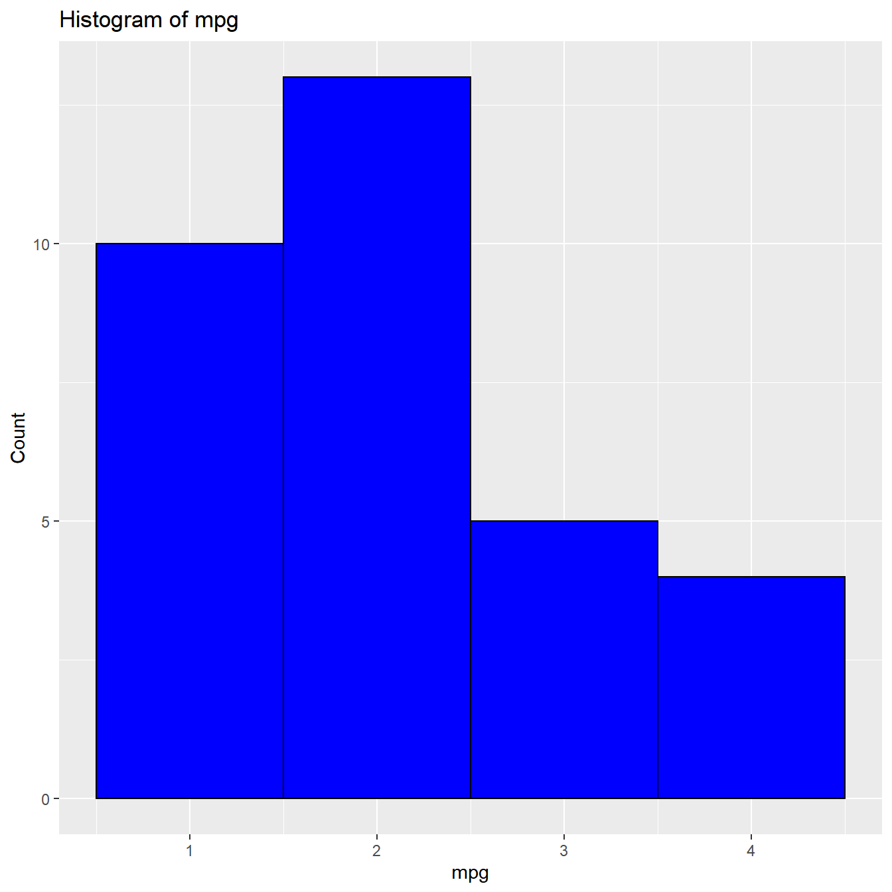
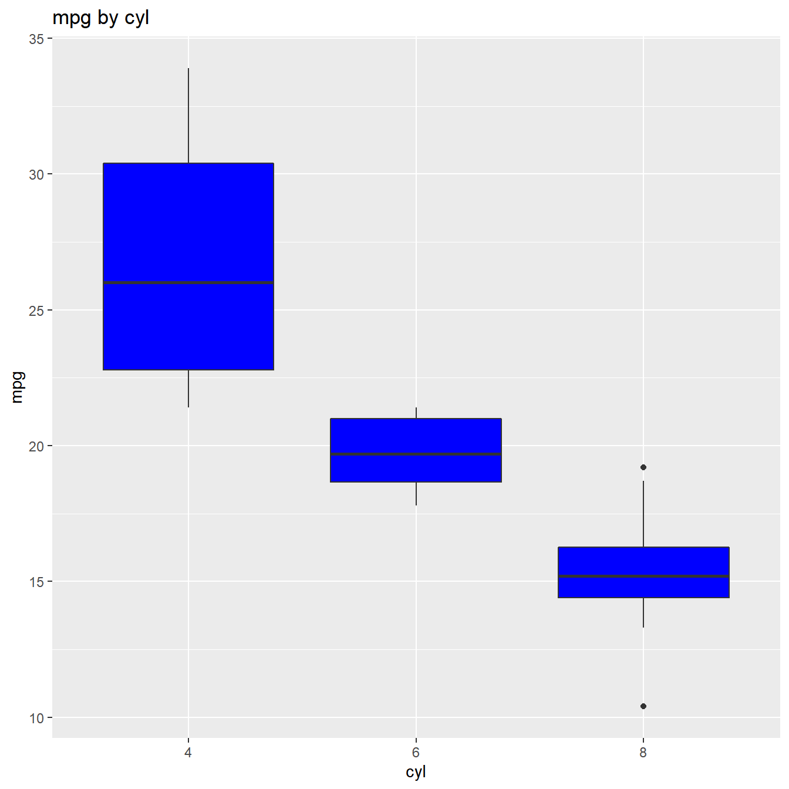

# Continuous Data

    #> Warning: package 'dplyr' was built under R version 4.5.3

## Introduction

This document introduces you to a basic set of functions that describe
data continuous data. The other two vignettes introduce you to functions
that describe categorical data and visualization options.

## Data

We have modified the `mtcars` data to create a new data set `mtcarz`.
The only difference between the two data sets is related to the variable
types.

[`str`](https://rdrr.io/r/utils/str.html)`(``mtcarz``)`` ``#> 'data.frame': 32 obs. of 11 variables:`` ``#> $ mpg : num 21 21 22.8 21.4 18.7 18.1 14.3 24.4 22.8 19.2 ...`` ``#> $ cyl : Factor w/ 3 levels "4","6","8": 2 2 1 2 3 2 3 1 1 2 ...`` ``#> $ disp: num 160 160 108 258 360 ...`` ``#> $ hp : num 110 110 93 110 175 105 245 62 95 123 ...`` ``#> $ drat: num 3.9 3.9 3.85 3.08 3.15 2.76 3.21 3.69 3.92 3.92 ...`` ``#> $ wt : num 2.62 2.88 2.32 3.21 3.44 ...`` ``#> $ qsec: num 16.5 17 18.6 19.4 17 ...`` ``#> $ vs : Factor w/ 2 levels "0","1": 1 1 2 2 1 2 1 2 2 2 ...`` ``#> $ am : Factor w/ 2 levels "0","1": 2 2 2 1 1 1 1 1 1 1 ...`` ``#> $ gear: Factor w/ 3 levels "3","4","5": 2 2 2 1 1 1 1 2 2 2 ...`` ``#> $ carb: Factor w/ 6 levels "1","2","3","4",..: 4 4 1 1 2 1 4 2 2 4 ...`

## Data Screening

The
[`ds_screener()`](https://descriptr.rsquaredacademy.com/reference/ds_screener.md)
function will screen a data set and return the following: -
Column/Variable Names - Data Type - Levels (in case of categorical
data) - Number of missing observations - % of missing observations

[`ds_screener`](https://descriptr.rsquaredacademy.com/reference/ds_screener.md)`(``mtcarz``)`` ``#> -----------------------------------------------------------------------`` ``#> | Column Name | Data Type | Levels | Missing | Missing (%) |`` ``#> -----------------------------------------------------------------------`` ``#> | mpg | numeric | NA | 0 | 0 |`` ``#> | cyl | factor | 4 6 8 | 0 | 0 |`` ``#> | disp | numeric | NA | 0 | 0 |`` ``#> | hp | numeric | NA | 0 | 0 |`` ``#> | drat | numeric | NA | 0 | 0 |`` ``#> | wt | numeric | NA | 0 | 0 |`` ``#> | qsec | numeric | NA | 0 | 0 |`` ``#> | vs | factor | 0 1 | 0 | 0 |`` ``#> | am | factor | 0 1 | 0 | 0 |`` ``#> | gear | factor | 3 4 5 | 0 | 0 |`` ``#> | carb | factor |1 2 3 4 6 8| 0 | 0 |`` ``#> -----------------------------------------------------------------------`` ``#> `` ``#> Overall Missing Values 0 `` ``#> Percentage of Missing Values 0 %`` ``#> Rows with Missing Values 0 `` ``#> Columns With Missing Values 0`

## Summary Statistics

The `ds_summary_stats` function returns a comprehensive set of
statistics including measures of location, variation, symmetry and
extreme observations.

[`ds_summary_stats`](https://descriptr.rsquaredacademy.com/reference/ds_summary_stats.md)`(``mtcarz``, ``mpg``)`` ``#> -------------------------------- Variable: mpg --------------------------------`` ``#> `` ``#> Univariate Analysis `` ``#> `` ``#> N 32.00 Variance 36.32 `` ``#> Missing 0.00 Std Deviation 6.03 `` ``#> Mean 20.09 Range 23.50 `` ``#> Median 19.20 Interquartile Range 7.38 `` ``#> Mode 10.40 Uncorrected SS 14042.31 `` ``#> Trimmed Mean 19.95 Corrected SS 1126.05 `` ``#> Skewness 0.67 Coeff Variation 30.00 `` ``#> Kurtosis -0.02 Std Error Mean 1.07 `` ``#> `` ``#> Quantiles `` ``#> `` ``#> Quantile Value `` ``#> `` ``#> Max 33.90 `` ``#> 99% 33.44 `` ``#> 95% 31.30 `` ``#> 90% 30.09 `` ``#> Q3 22.80 `` ``#> Median 19.20 `` ``#> Q1 15.43 `` ``#> 10% 14.34 `` ``#> 5% 12.00 `` ``#> 1% 10.40 `` ``#> Min 10.40 `` ``#> `` ``#> Extreme Values `` ``#> `` ``#> Low High `` ``#> `` ``#> Obs Value Obs Value `` ``#> 15 10.4 20 33.9 `` ``#> 16 10.4 18 32.4 `` ``#> 24 13.3 19 30.4 `` ``#> 7 14.3 28 30.4 `` ``#> 17 14.7 26 27.3`

You can pass multiple variables as shown below:

[`ds_summary_stats`](https://descriptr.rsquaredacademy.com/reference/ds_summary_stats.md)`(``mtcarz``, ``mpg``, ``disp``)`` ``#> -------------------------------- Variable: mpg --------------------------------`` ``#> `` ``#> Univariate Analysis `` ``#> `` ``#> N 32.00 Variance 36.32 `` ``#> Missing 0.00 Std Deviation 6.03 `` ``#> Mean 20.09 Range 23.50 `` ``#> Median 19.20 Interquartile Range 7.38 `` ``#> Mode 10.40 Uncorrected SS 14042.31 `` ``#> Trimmed Mean 19.95 Corrected SS 1126.05 `` ``#> Skewness 0.67 Coeff Variation 30.00 `` ``#> Kurtosis -0.02 Std Error Mean 1.07 `` ``#> `` ``#> Quantiles `` ``#> `` ``#> Quantile Value `` ``#> `` ``#> Max 33.90 `` ``#> 99% 33.44 `` ``#> 95% 31.30 `` ``#> 90% 30.09 `` ``#> Q3 22.80 `` ``#> Median 19.20 `` ``#> Q1 15.43 `` ``#> 10% 14.34 `` ``#> 5% 12.00 `` ``#> 1% 10.40 `` ``#> Min 10.40 `` ``#> `` ``#> Extreme Values `` ``#> `` ``#> Low High `` ``#> `` ``#> Obs Value Obs Value `` ``#> 15 10.4 20 33.9 `` ``#> 16 10.4 18 32.4 `` ``#> 24 13.3 19 30.4 `` ``#> 7 14.3 28 30.4 `` ``#> 17 14.7 26 27.3 `` ``#> `` ``#> `` ``#> `` ``#> -------------------------------- Variable: disp --------------------------------`` ``#> `` ``#> Univariate Analysis `` ``#> `` ``#> N 32.00 Variance 15360.80 `` ``#> Missing 0.00 Std Deviation 123.94 `` ``#> Mean 230.72 Range 400.90 `` ``#> Median 196.30 Interquartile Range 205.18 `` ``#> Mode 275.80 Uncorrected SS 2179627.47 `` ``#> Trimmed Mean 228.00 Corrected SS 476184.79 `` ``#> Skewness 0.42 Coeff Variation 53.72 `` ``#> Kurtosis -1.07 Std Error Mean 21.91 `` ``#> `` ``#> Quantiles `` ``#> `` ``#> Quantile Value `` ``#> `` ``#> Max 472.00 `` ``#> 99% 468.28 `` ``#> 95% 449.00 `` ``#> 90% 396.00 `` ``#> Q3 326.00 `` ``#> Median 196.30 `` ``#> Q1 120.83 `` ``#> 10% 80.61 `` ``#> 5% 77.35 `` ``#> 1% 72.53 `` ``#> Min 71.10 `` ``#> `` ``#> Extreme Values `` ``#> `` ``#> Low High `` ``#> `` ``#> Obs Value Obs Value `` ``#> 20 71.1 15 472 `` ``#> 19 75.7 16 460 `` ``#> 18 78.7 17 440 `` ``#> 26 79 25 400 `` ``#> 28 95.1 5 360`

If you do not specify any variables, it will detect all the continuous
variables in the data set and return summary statistics for each of
them.

## Frequency Distribution

The `ds_freq_table` function creates frequency tables for continuous
variables. The default number of intervals is 5.

[`ds_freq_table`](https://descriptr.rsquaredacademy.com/reference/ds_freq_table.md)`(``mtcarz``, ``mpg``, ``4``)`` ``#> Variable: mpg `` ``#> |---------------------------------------------------------------------------|`` ``#> | Bins | Frequency | Cum Frequency | Percent | Cum Percent |`` ``#> |---------------------------------------------------------------------------|`` ``#> | 10.4 - 16.3 | 10 | 10 | 31.25 | 31.25 |`` ``#> |---------------------------------------------------------------------------|`` ``#> | 16.3 - 22.1 | 13 | 23 | 40.62 | 71.88 |`` ``#> |---------------------------------------------------------------------------|`` ``#> | 22.1 - 28 | 5 | 28 | 15.62 | 87.5 |`` ``#> |---------------------------------------------------------------------------|`` ``#> | 28 - 33.9 | 4 | 32 | 12.5 | 100 |`` ``#> |---------------------------------------------------------------------------|`` ``#> | Total | 32 | - | 100.00 | - |`` ``#> |---------------------------------------------------------------------------|`

### Histogram

A [`plot()`](https://rdrr.io/r/graphics/plot.default.html) method has
been defined which will generate a histogram.

`k`` ``<-`` `[`ds_freq_table`](https://descriptr.rsquaredacademy.com/reference/ds_freq_table.md)`(``mtcarz``, ``mpg``, ``4``)`` `[`plot`](https://rdrr.io/r/graphics/plot.default.html)`(``k``)`

## Auto Summary

If you want to view summary statistics and frequency tables of all or
subset of variables in a data set, use `ds_auto_summary()`.

[`ds_auto_summary_stats`](https://descriptr.rsquaredacademy.com/reference/ds_auto_summary_stats.md)`(``mtcarz``, ``disp``, ``mpg``)`` ``#> -------------------------------- Variable: disp --------------------------------`` ``#> `` ``#> ------------------------------ Summary Statistics ------------------------------`` ``#> `` ``#> -------------------------------- Variable: disp --------------------------------`` ``#> `` ``#> Univariate Analysis `` ``#> `` ``#> N 32.00 Variance 15360.80 `` ``#> Missing 0.00 Std Deviation 123.94 `` ``#> Mean 230.72 Range 400.90 `` ``#> Median 196.30 Interquartile Range 205.18 `` ``#> Mode 275.80 Uncorrected SS 2179627.47 `` ``#> Trimmed Mean 228.00 Corrected SS 476184.79 `` ``#> Skewness 0.42 Coeff Variation 53.72 `` ``#> Kurtosis -1.07 Std Error Mean 21.91 `` ``#> `` ``#> Quantiles `` ``#> `` ``#> Quantile Value `` ``#> `` ``#> Max 472.00 `` ``#> 99% 468.28 `` ``#> 95% 449.00 `` ``#> 90% 396.00 `` ``#> Q3 326.00 `` ``#> Median 196.30 `` ``#> Q1 120.83 `` ``#> 10% 80.61 `` ``#> 5% 77.35 `` ``#> 1% 72.53 `` ``#> Min 71.10 `` ``#> `` ``#> Extreme Values `` ``#> `` ``#> Low High `` ``#> `` ``#> Obs Value Obs Value `` ``#> 20 71.1 15 472 `` ``#> 19 75.7 16 460 `` ``#> 18 78.7 17 440 `` ``#> 26 79 25 400 `` ``#> 28 95.1 5 360 `` ``#> `` ``#> `` ``#> `` ``#> NULL`` ``#> `` ``#> `` ``#> ---------------------------- Frequency Distribution ----------------------------`` ``#> `` ``#> Variable: disp `` ``#> |---------------------------------------------------------------------------|`` ``#> | Bins | Frequency | Cum Frequency | Percent | Cum Percent |`` ``#> |---------------------------------------------------------------------------|`` ``#> | 71.1 - 151.3 | 12 | 12 | 37.5 | 37.5 |`` ``#> |---------------------------------------------------------------------------|`` ``#> | 151.3 - 231.5 | 5 | 17 | 15.62 | 53.12 |`` ``#> |---------------------------------------------------------------------------|`` ``#> | 231.5 - 311.6 | 6 | 23 | 18.75 | 71.88 |`` ``#> |---------------------------------------------------------------------------|`` ``#> | 311.6 - 391.8 | 5 | 28 | 15.62 | 87.5 |`` ``#> |---------------------------------------------------------------------------|`` ``#> | 391.8 - 472 | 4 | 32 | 12.5 | 100 |`` ``#> |---------------------------------------------------------------------------|`` ``#> | Total | 32 | - | 100.00 | - |`` ``#> |---------------------------------------------------------------------------|`` ``#> `` ``#> `` ``#> -------------------------------- Variable: mpg --------------------------------`` ``#> `` ``#> ------------------------------ Summary Statistics ------------------------------`` ``#> `` ``#> -------------------------------- Variable: mpg --------------------------------`` ``#> `` ``#> Univariate Analysis `` ``#> `` ``#> N 32.00 Variance 36.32 `` ``#> Missing 0.00 Std Deviation 6.03 `` ``#> Mean 20.09 Range 23.50 `` ``#> Median 19.20 Interquartile Range 7.38 `` ``#> Mode 10.40 Uncorrected SS 14042.31 `` ``#> Trimmed Mean 19.95 Corrected SS 1126.05 `` ``#> Skewness 0.67 Coeff Variation 30.00 `` ``#> Kurtosis -0.02 Std Error Mean 1.07 `` ``#> `` ``#> Quantiles `` ``#> `` ``#> Quantile Value `` ``#> `` ``#> Max 33.90 `` ``#> 99% 33.44 `` ``#> 95% 31.30 `` ``#> 90% 30.09 `` ``#> Q3 22.80 `` ``#> Median 19.20 `` ``#> Q1 15.43 `` ``#> 10% 14.34 `` ``#> 5% 12.00 `` ``#> 1% 10.40 `` ``#> Min 10.40 `` ``#> `` ``#> Extreme Values `` ``#> `` ``#> Low High `` ``#> `` ``#> Obs Value Obs Value `` ``#> 15 10.4 20 33.9 `` ``#> 16 10.4 18 32.4 `` ``#> 24 13.3 19 30.4 `` ``#> 7 14.3 28 30.4 `` ``#> 17 14.7 26 27.3 `` ``#> `` ``#> `` ``#> `` ``#> NULL`` ``#> `` ``#> `` ``#> ---------------------------- Frequency Distribution ----------------------------`` ``#> `` ``#> Variable: mpg `` ``#> |-----------------------------------------------------------------------|`` ``#> | Bins | Frequency | Cum Frequency | Percent | Cum Percent |`` ``#> |-----------------------------------------------------------------------|`` ``#> | 10.4 - 15.1 | 6 | 6 | 18.75 | 18.75 |`` ``#> |-----------------------------------------------------------------------|`` ``#> | 15.1 - 19.8 | 12 | 18 | 37.5 | 56.25 |`` ``#> |-----------------------------------------------------------------------|`` ``#> | 19.8 - 24.5 | 8 | 26 | 25 | 81.25 |`` ``#> |-----------------------------------------------------------------------|`` ``#> | 24.5 - 29.2 | 2 | 28 | 6.25 | 87.5 |`` ``#> |-----------------------------------------------------------------------|`` ``#> | 29.2 - 33.9 | 4 | 32 | 12.5 | 100 |`` ``#> |-----------------------------------------------------------------------|`` ``#> | Total | 32 | - | 100.00 | - |`` ``#> |-----------------------------------------------------------------------|`

## Group Summary

The
[`ds_group_summary()`](https://descriptr.rsquaredacademy.com/reference/ds_group_summary.md)
function returns descriptive statistics of a continuous variable for the
different levels of a categorical variable.

`k`` ``<-`` `[`ds_group_summary`](https://descriptr.rsquaredacademy.com/reference/ds_group_summary.md)`(``mtcarz``, ``cyl``, ``mpg``)`` ``k`` ``#> by `` ``#> -----------------------------------------------------------------------------------------`` ``#> | Statistic/Levels| 4| 6| 8|`` ``#> -----------------------------------------------------------------------------------------`` ``#> | Obs| 11| 7| 14|`` ``#> | Minimum| 21.4| 17.8| 10.4|`` ``#> | Maximum| 33.9| 21.4| 19.2|`` ``#> | Mean| 26.66| 19.74| 15.1|`` ``#> | Median| 26| 19.7| 15.2|`` ``#> | Mode| 22.8| 21| 10.4|`` ``#> | Std. Deviation| 4.51| 1.45| 2.56|`` ``#> | Variance| 20.34| 2.11| 6.55|`` ``#> | Skewness| 0.35| -0.26| -0.46|`` ``#> | Kurtosis| -1.43| -1.83| 0.33|`` ``#> | Uncorrected SS| 8023.83| 2741.14| 3277.34|`` ``#> | Corrected SS| 203.39| 12.68| 85.2|`` ``#> | Coeff Variation| 16.91| 7.36| 16.95|`` ``#> | Std. Error Mean| 1.36| 0.55| 0.68|`` ``#> | Range| 12.5| 3.6| 8.8|`` ``#> | Interquartile Range| 7.6| 2.35| 1.85|`` ``#> -----------------------------------------------------------------------------------------`

[`ds_group_summary()`](https://descriptr.rsquaredacademy.com/reference/ds_group_summary.md)
returns a tibble which can be used for further analysis.

`k``$``tidy_stats`` ``#> ``# A tibble: 3 × 15`` ``#> cyl length min max mean median mode sd variance skewness kurtosis`` ``#> ``<fct>`` ``<int>`` ``<dbl>`` ``<dbl>`` ``<dbl>`` ``<dbl>`` ``<dbl>`` ``<dbl>`` ``<dbl>`` ``<dbl>`` ``<dbl>`` ``#> ``1`` 4 11 21.4 33.9 26.7 26 22.8 4.51 20.3 0.348 -``1.43`` `` ``#> ``2`` 6 7 17.8 21.4 19.7 19.7 21 1.45 2.11 -``0.259`` -``1.83`` `` ``#> ``3`` 8 14 10.4 19.2 15.1 15.2 10.4 2.56 6.55 -``0.456`` 0.330`` ``#> ``# ℹ 4 more variables: coeff_var <dbl>, std_error <dbl>, range <dbl>, iqr <dbl>`

### Box Plot

A [`plot()`](https://rdrr.io/r/graphics/plot.default.html) method has
been defined for comparing distributions.

`k`` ``<-`` `[`ds_group_summary`](https://descriptr.rsquaredacademy.com/reference/ds_group_summary.md)`(``mtcarz``, ``cyl``, ``mpg``)`` `[`plot`](https://rdrr.io/r/graphics/plot.default.html)`(``k``)`

### Multiple Variables

If you want grouped summary statistics for multiple variables in a data
set, use
[`ds_auto_group_summary()`](https://descriptr.rsquaredacademy.com/reference/ds_auto_group_summary.md).

[`ds_auto_group_summary`](https://descriptr.rsquaredacademy.com/reference/ds_auto_group_summary.md)`(``mtcarz``, ``cyl``, ``gear``, ``mpg``)`` ``#> by `` ``#> -----------------------------------------------------------------------------------------`` ``#> | Statistic/Levels| 4| 6| 8|`` ``#> -----------------------------------------------------------------------------------------`` ``#> | Obs| 11| 7| 14|`` ``#> | Minimum| 21.4| 17.8| 10.4|`` ``#> | Maximum| 33.9| 21.4| 19.2|`` ``#> | Mean| 26.66| 19.74| 15.1|`` ``#> | Median| 26| 19.7| 15.2|`` ``#> | Mode| 22.8| 21| 10.4|`` ``#> | Std. Deviation| 4.51| 1.45| 2.56|`` ``#> | Variance| 20.34| 2.11| 6.55|`` ``#> | Skewness| 0.35| -0.26| -0.46|`` ``#> | Kurtosis| -1.43| -1.83| 0.33|`` ``#> | Uncorrected SS| 8023.83| 2741.14| 3277.34|`` ``#> | Corrected SS| 203.39| 12.68| 85.2|`` ``#> | Coeff Variation| 16.91| 7.36| 16.95|`` ``#> | Std. Error Mean| 1.36| 0.55| 0.68|`` ``#> | Range| 12.5| 3.6| 8.8|`` ``#> | Interquartile Range| 7.6| 2.35| 1.85|`` ``#> -----------------------------------------------------------------------------------------`` ``#> `` ``#> `` ``#> `` ``#> by `` ``#> -----------------------------------------------------------------------------------------`` ``#> | Statistic/Levels| 3| 4| 5|`` ``#> -----------------------------------------------------------------------------------------`` ``#> | Obs| 15| 12| 5|`` ``#> | Minimum| 10.4| 17.8| 15|`` ``#> | Maximum| 21.5| 33.9| 30.4|`` ``#> | Mean| 16.11| 24.53| 21.38|`` ``#> | Median| 15.5| 22.8| 19.7|`` ``#> | Mode| 10.4| 21| 15|`` ``#> | Std. Deviation| 3.37| 5.28| 6.66|`` ``#> | Variance| 11.37| 27.84| 44.34|`` ``#> | Skewness| -0.09| 0.7| 0.56|`` ``#> | Kurtosis| -0.38| -0.77| -1.83|`` ``#> | Uncorrected SS| 4050.52| 7528.9| 2462.89|`` ``#> | Corrected SS| 159.15| 306.29| 177.37|`` ``#> | Coeff Variation| 20.93| 21.51| 31.15|`` ``#> | Std. Error Mean| 0.87| 1.52| 2.98|`` ``#> | Range| 11.1| 16.1| 15.4|`` ``#> | Interquartile Range| 3.9| 7.08| 10.2|`` ``#> -----------------------------------------------------------------------------------------`

### Combination of Categories

To look at the descriptive statistics of a continuous variable for
different combinations of levels of two or more categorical variables,
use
[`ds_group_summary_interact()`](https://descriptr.rsquaredacademy.com/reference/ds_group_summary_interact.md).

[`ds_group_summary_interact`](https://descriptr.rsquaredacademy.com/reference/ds_group_summary_interact.md)`(``mtcarz``, ``mpg``, ``cyl``, ``gear``)`` ``#> ``# A tibble: 8 × 17`` ``#> cyl gear min max mean t_mean median mode range variance stdev`` ``#> ``<chr>`` ``<chr>`` ``<dbl>`` ``<dbl>`` ``<dbl>`` ``<dbl>`` ``<dbl>`` ``<dbl>`` ``<dbl>`` ``<dbl>`` ``<dbl>`` ``#> ``1`` 4 3 21.5 21.5 21.5 21.5 21.5 21.5 0 ``NA`` ``NA`` `` ``#> ``2`` 6 3 18.1 21.4 19.8 19.8 19.8 18.1 3.30 5.44 2.33 `` ``#> ``3`` 8 3 10.4 19.2 15.0 15.0 15.2 10.4 8.8 7.70 2.77 `` ``#> ``4`` 4 4 21.4 33.9 26.9 26.9 25.8 22.8 12.5 23.1 4.81 `` ``#> ``5`` 6 4 17.8 21 19.8 19.8 20.1 21 3.2 2.41 1.55 `` ``#> ``6`` 4 5 26 30.4 28.2 28.2 28.2 26 4.4 9.68 3.11 `` ``#> ``7`` 6 5 19.7 19.7 19.7 19.7 19.7 19.7 0 ``NA`` ``NA`` `` ``#> ``8`` 8 5 15 15.8 15.4 15.4 15.4 15 0.800 0.320 0.566`` ``#> ``# ℹ 6 more variables: skew <dbl>, kurtosis <dbl>, coeff_var <dbl>, q1 <dbl>,`` ``#> ``# q3 <dbl>, iqrange <dbl>`

## Multiple Variable Statistics

The
[`ds_tidy_stats()`](https://descriptr.rsquaredacademy.com/reference/ds_tidy_stats.md)
function returns summary/descriptive statistics for variables in a data
frame/tibble.

[`ds_tidy_stats`](https://descriptr.rsquaredacademy.com/reference/ds_tidy_stats.md)`(``mtcarz``, ``mpg``, ``disp``, ``hp``)`` ``#> ``# A tibble: 3 × 16`` ``#> vars min max mean t_mean median mode range variance stdev skew`` ``#> ``<chr>`` ``<dbl>`` ``<dbl>`` ``<dbl>`` ``<dbl>`` ``<dbl>`` ``<dbl>`` ``<dbl>`` ``<dbl>`` ``<dbl>`` ``<dbl>`` ``#> ``1`` disp 71.1 472 231. 228 196. 276. 401. ``15``361. 124. 0.420`` ``#> ``2`` hp 52 335 147. 144. 123 110 283 ``4``701. 68.6 0.799`` ``#> ``3`` mpg 10.4 33.9 20.1 20.0 19.2 10.4 23.5 36.3 6.03 0.672`` ``#> ``# ℹ 5 more variables: kurtosis <dbl>, coeff_var <dbl>, q1 <dbl>, q3 <dbl>,`` ``#> ``# iqrange <dbl>`

## Measures

If you want to view the measure of location, variation, symmetry,
percentiles and extreme observations as tibbles, use the below
functions. All of them, except for
[`ds_extreme_obs()`](https://descriptr.rsquaredacademy.com/reference/ds_extreme_obs.md)
will work with single or multiple variables. If you do not specify the
variables, they will return the results for all the continuous variables
in the data set.

#### Measures of Location

[`ds_measures_location`](https://descriptr.rsquaredacademy.com/reference/ds_measures_location.md)`(``mtcarz``)`` ``#> variable n missing mean trim_mean median mode`` ``#> 1 disp 32 0 230.72 228.00 196.30 275.80`` ``#> 2 drat 32 0 3.60 3.58 3.70 3.07`` ``#> 3 hp 32 0 146.69 143.57 123.00 110.00`` ``#> 4 mpg 32 0 20.09 19.95 19.20 10.40`` ``#> 5 qsec 32 0 17.85 17.79 17.71 17.02`` ``#> 6 wt 32 0 3.22 3.20 3.33 3.44`

#### Measures of Variation

[`ds_measures_variation`](https://descriptr.rsquaredacademy.com/reference/ds_measures_variation.md)`(``mtcarz``)`` ``#> var n range iqr variance sd coeff_var std_error`` ``#> 1 disp 32 400.900 205.17500 1.536080e+04 123.9386938 53.71779 21.90947271`` ``#> 2 drat 32 2.170 0.84000 2.858814e-01 0.5346787 14.86638 0.09451874`` ``#> 3 hp 32 283.000 83.50000 4.700867e+03 68.5628685 46.74077 12.12031731`` ``#> 4 mpg 32 23.500 7.37500 3.632410e+01 6.0269481 29.99881 1.06542396`` ``#> 5 qsec 32 8.400 2.00750 3.193166e+00 1.7869432 10.01159 0.31588992`` ``#> 6 wt 32 3.911 1.02875 9.573790e-01 0.9784574 30.41285 0.17296847`

#### Measures of Symmetry

[`ds_measures_symmetry`](https://descriptr.rsquaredacademy.com/reference/ds_measures_symmetry.md)`(``mtcarz``)`` ``#> var n skewness kurtosis`` ``#> 1 disp 32 0.4202331 -1.06752340`` ``#> 2 drat 32 0.2927802 -0.45043245`` ``#> 3 hp 32 0.7994067 0.27521159`` ``#> 4 mpg 32 0.6723771 -0.02200629`` ``#> 5 qsec 32 0.4063466 0.86493065`` ``#> 6 wt 32 0.4659161 0.41659467`

#### Percentiles

[`ds_percentiles`](https://descriptr.rsquaredacademy.com/reference/ds_percentiles.md)`(``mtcarz``)`` ``#> var n min per_1 per_5 per_10 q1 median q3 per_90`` ``#> 1 disp 32 71.100 72.52600 77.3500 80.6100 120.82500 196.300 326.00 396.0000`` ``#> 2 drat 32 2.760 2.76000 2.8535 3.0070 3.08000 3.695 3.92 4.2090`` ``#> 3 hp 32 52.000 55.10000 63.6500 66.0000 96.50000 123.000 180.00 243.5000`` ``#> 4 mpg 32 10.400 10.40000 11.9950 14.3400 15.42500 19.200 22.80 30.0900`` ``#> 5 qsec 32 14.500 14.53100 15.0455 15.5340 16.89250 17.710 18.90 19.9900`` ``#> 6 wt 32 1.513 1.54462 1.7360 1.9555 2.58125 3.325 3.61 4.0475`` ``#> per_95 per_99 max`` ``#> 1 449.00000 468.28000 472.000`` ``#> 2 4.31450 4.77500 4.930`` ``#> 3 253.55000 312.99000 335.000`` ``#> 4 31.30000 33.43500 33.900`` ``#> 5 20.10450 22.06920 22.900`` ``#> 6 5.29275 5.39951 5.424`

#### Extreme Observations

[`ds_extreme_obs`](https://descriptr.rsquaredacademy.com/reference/ds_extreme_obs.md)`(``mtcarz``, ``mpg``)`` ``#> type value index`` ``#> 1 high 33.9 20`` ``#> 2 high 32.4 18`` ``#> 3 high 30.4 19`` ``#> 4 high 30.4 28`` ``#> 5 high 27.3 26`` ``#> 6 low 10.4 15`` ``#> 7 low 10.4 16`` ``#> 8 low 13.3 24`` ``#> 9 low 14.3 7`` ``#> 10 low 14.7 17`
