# Visualization

    #> Warning: package 'dplyr' was built under R version 4.5.3

## Introduction

In this document, we will introduce you to functions for generating
different types of plots.

## Data

We have modified the `mtcars` data to create a new data set `mtcarz`.
The only difference between the two data sets is related to the variable
types.

[`str`](https://rdrr.io/r/utils/str.html)`(``mtcarz``)`` ``#> 'data.frame': 32 obs. of 11 variables:`` ``#> $ mpg : num 21 21 22.8 21.4 18.7 18.1 14.3 24.4 22.8 19.2 ...`` ``#> $ cyl : Factor w/ 3 levels "4","6","8": 2 2 1 2 3 2 3 1 1 2 ...`` ``#> $ disp: num 160 160 108 258 360 ...`` ``#> $ hp : num 110 110 93 110 175 105 245 62 95 123 ...`` ``#> $ drat: num 3.9 3.9 3.85 3.08 3.15 2.76 3.21 3.69 3.92 3.92 ...`` ``#> $ wt : num 2.62 2.88 2.32 3.21 3.44 ...`` ``#> $ qsec: num 16.5 17 18.6 19.4 17 ...`` ``#> $ vs : Factor w/ 2 levels "0","1": 1 1 2 2 1 2 1 2 2 2 ...`` ``#> $ am : Factor w/ 2 levels "0","1": 2 2 2 1 1 1 1 1 1 1 ...`` ``#> $ gear: Factor w/ 3 levels "3","4","5": 2 2 2 1 1 1 1 2 2 2 ...`` ``#> $ carb: Factor w/ 6 levels "1","2","3","4",..: 4 4 1 1 2 1 4 2 2 4 ...`

## Continuous Data

The following functions will create plots for all or subset of
continuous variables in the data set.

#### Histograms

[`ds_plot_histogram`](https://descriptr.rsquaredacademy.com/reference/ds_plot_histogram.md)`(``mtcarz``)`

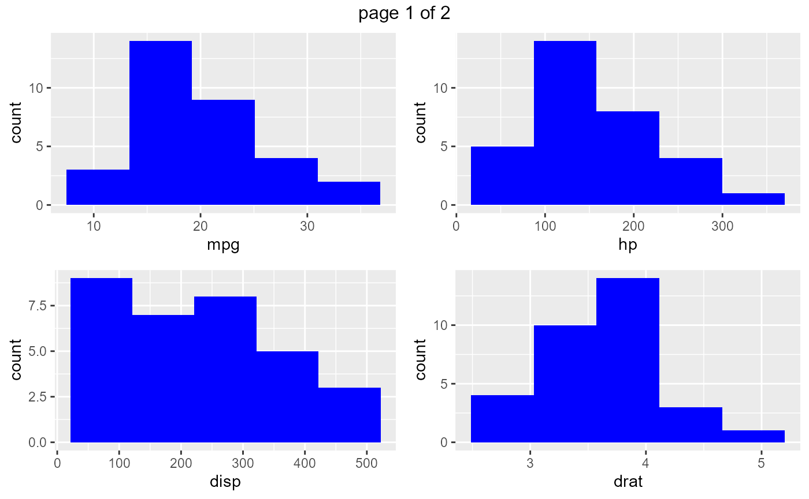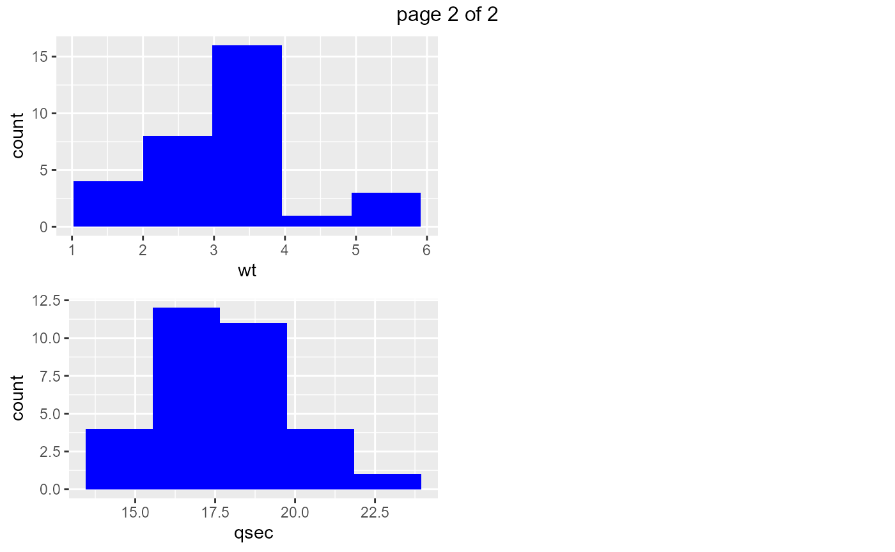

#### Density Plots

[`ds_plot_density`](https://descriptr.rsquaredacademy.com/reference/ds_plot_density.md)`(``mtcarz``)`

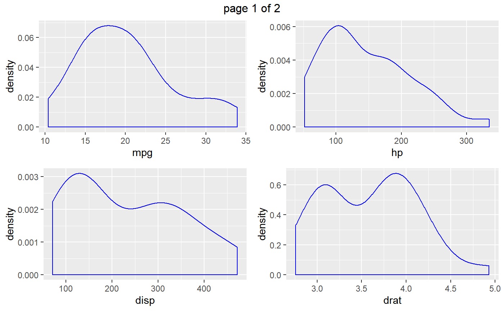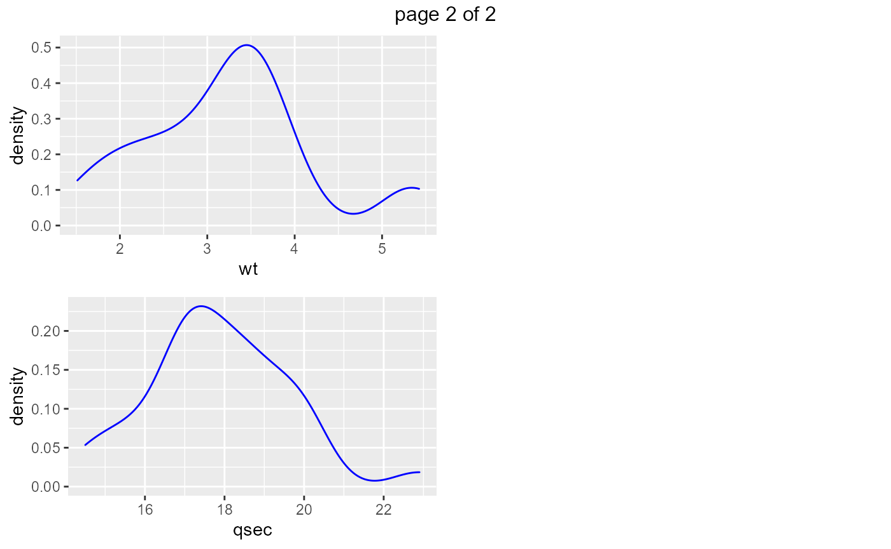

#### Box Plots

[`ds_plot_box_single`](https://descriptr.rsquaredacademy.com/reference/ds_plot_box_single.md)`(``mtcarz``)`

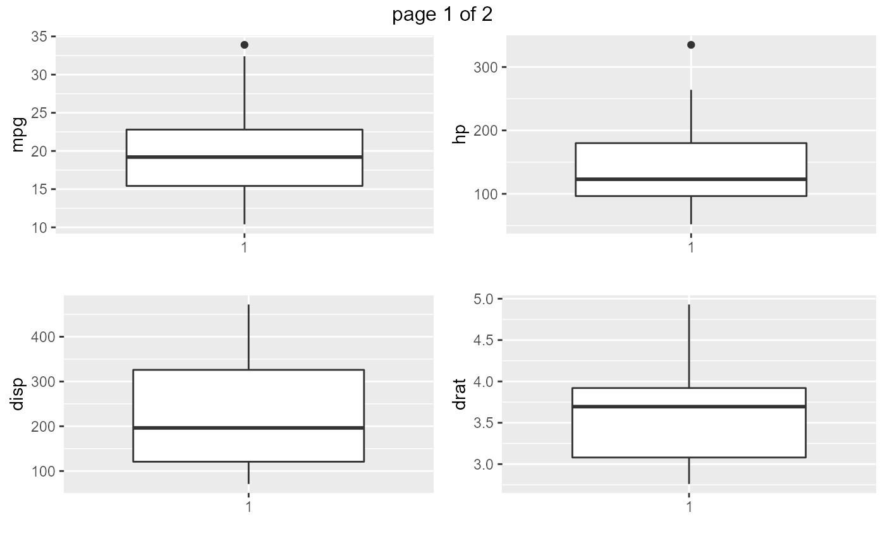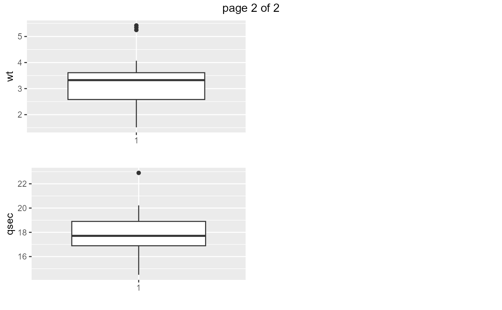

#### Scatter Plots

[`ds_plot_scatter`](https://descriptr.rsquaredacademy.com/reference/ds_plot_scatter.md)`(``mtcarz``, ``mpg``, ``disp``, ``hp``)`

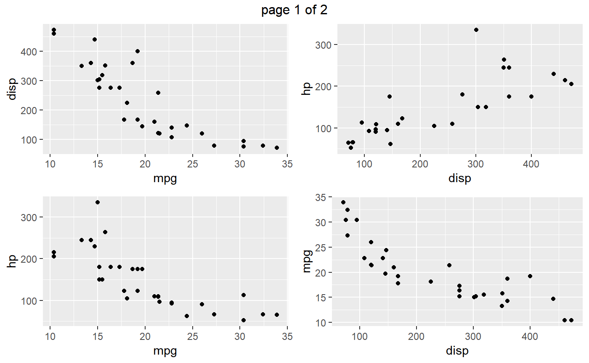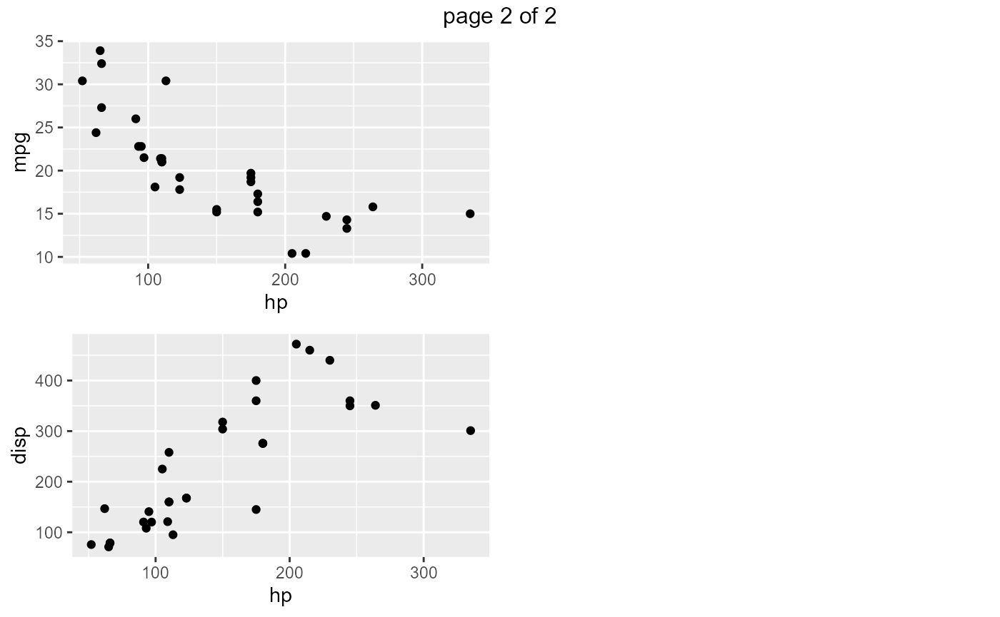

## Categorical Data

The following functions will create plots for all or subset of
categorical variables in the data set.

#### Bar Plot

[`ds_plot_bar`](https://descriptr.rsquaredacademy.com/reference/ds_plot_bar.md)`(``mtcarz``)`

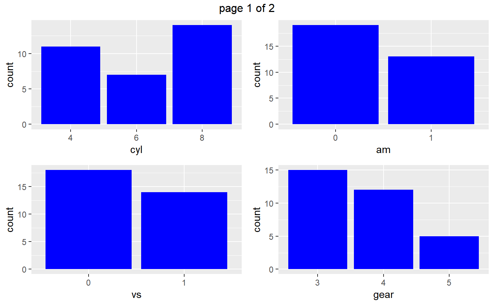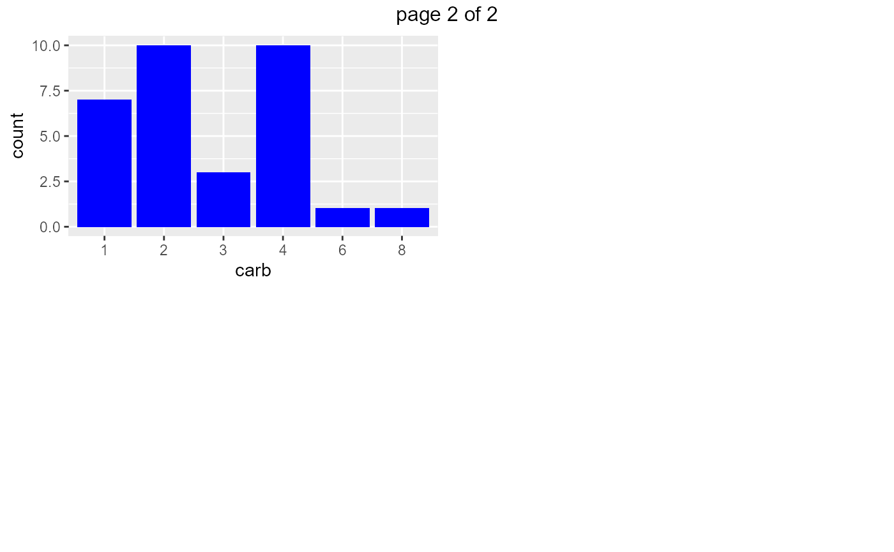

#### Stacked Bar Plot

[`ds_plot_bar_stacked`](https://descriptr.rsquaredacademy.com/reference/ds_plot_bar_stacked.md)`(``mtcarz``, ``cyl``, ``gear``, ``am``)`

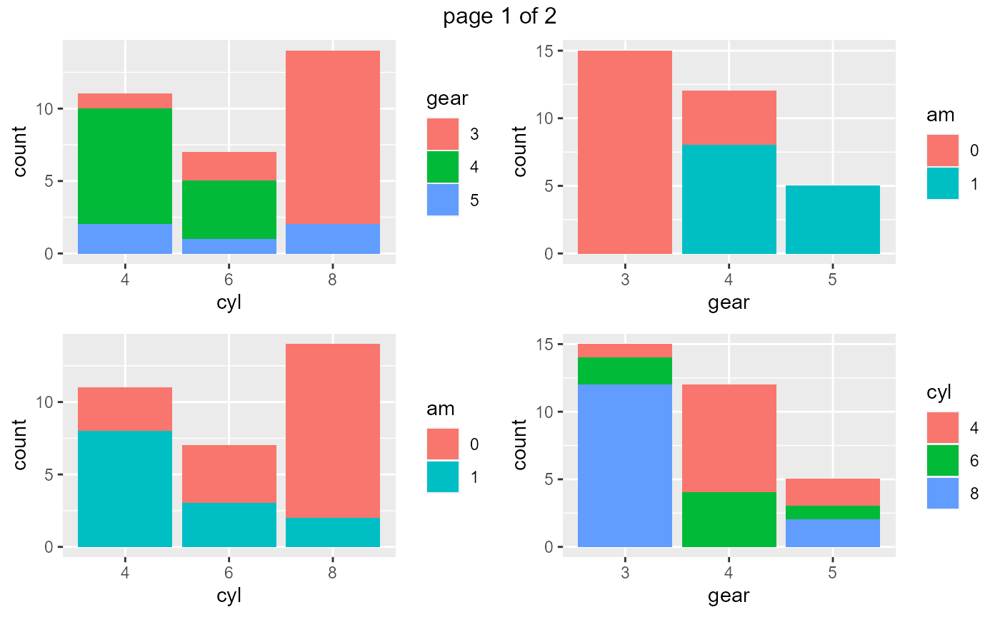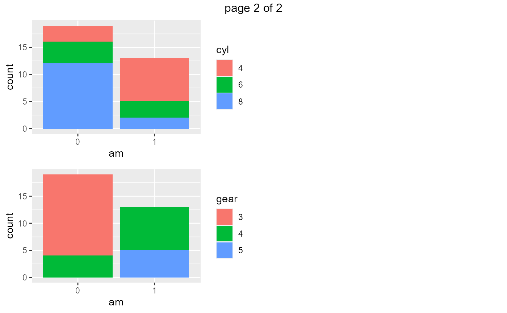

#### Grouped Bar Plot

[`ds_plot_bar_grouped`](https://descriptr.rsquaredacademy.com/reference/ds_plot_bar_grouped.md)`(``mtcarz``, ``cyl``, ``gear``, ``am``)`

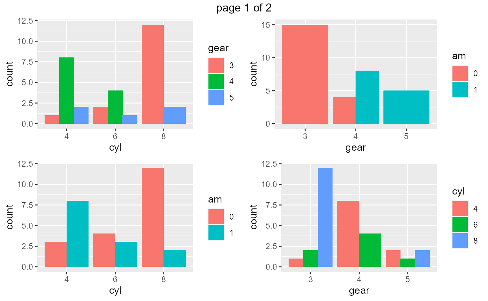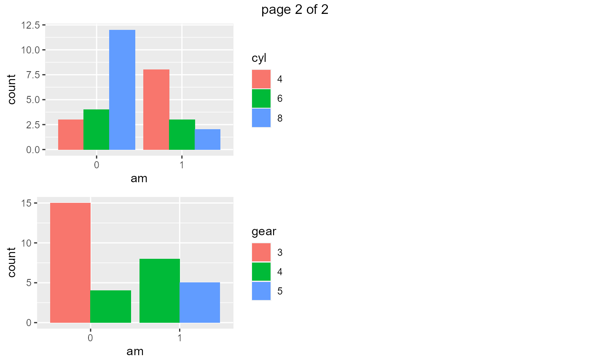

#### Grouped Box Plots

[`ds_plot_box_group`](https://descriptr.rsquaredacademy.com/reference/ds_plot_box_group.md)`(``mtcarz``, ``cyl``, ``gear``, ``mpg``, ``disp``)`

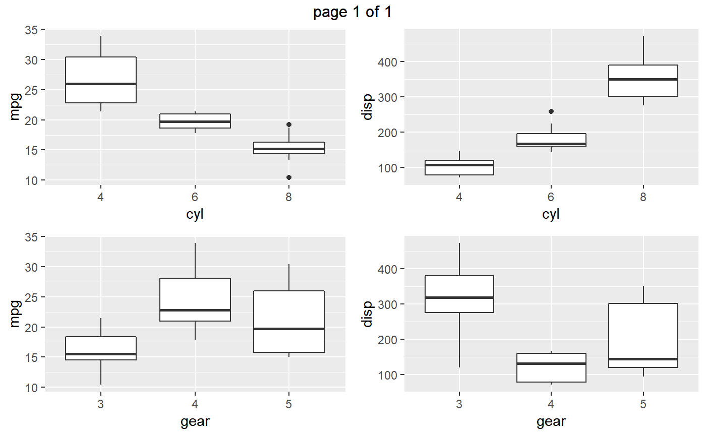
